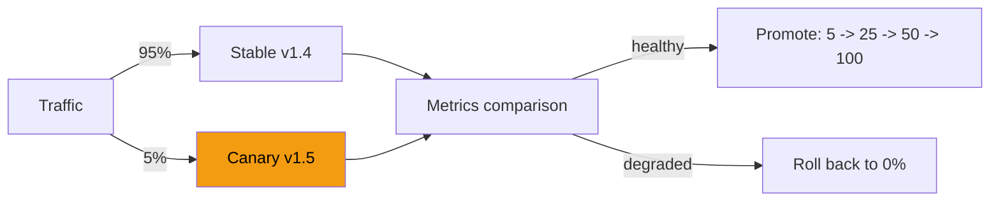

# Canary Deployment

> Expose a small share of real traffic to the new version, and let the metrics decide.

**Group:** Operations

## What it is

Roll the new version out to a small percentage of traffic, compare its metrics against the current version, and increase the share in steps if it looks healthy. If it does not, route everything back to the old version.

The distinction from [blue-green](blue-green-deployment.md): blue-green switches everyone at once and relies on fast rollback. A canary limits how many users are exposed to a bad release in the first place, and it produces evidence from production before committing.

## The failure it prevents

A bad release reaching everyone. Some failures cannot be found in staging: a memory leak that appears after two hours under real load, a query plan that changes at production data volume, a race that needs real concurrency, or a client population you cannot simulate. A canary finds them with 1 percent of users affected instead of 100.

## How it works

Progression is usually 1 percent, then 5, 25, 50, and 100, with a bake time at each step. The bake time must be long enough for the failure mode you are worried about: a crash appears in seconds, a memory leak in hours.

**Automated analysis is what makes this pattern work at scale.** Comparing canary metrics to stable metrics by hand, for every deploy, is not sustainable. Tools such as Argo Rollouts, Flagger, and Spinnaker's Kayenta run the comparison and promote or roll back on the result.

Two ways to select who gets the canary, and the difference matters:

- **Random percentage of requests.** Simple, and a single user may hit both versions across requests, which is confusing for anything stateful.
- **Sticky by user or session.** A user consistently gets one version. This is required if the change is user-visible, and it is what you want for measuring product metrics.

## Knobs and typical numbers

| Knob | Typical starting value | Raise it when | Lower it when |
|---|---|---|---|
| Initial traffic share | 1 to 5% | Traffic is low and 1% is not enough signal | Blast radius must be tiny |
| Bake time per step | 10 to 30 minutes | Slow-burning failures such as leaks | Fast feedback and high confidence |
| Promotion steps | 5 to 25 to 50 to 100 | Rarely more granular | Fewer steps for low-risk changes |
| Automatic rollback threshold | Error rate above stable by a small margin, p99 latency above stable by 10 to 20% | Noisy metrics cause false rollbacks | Sensitive services |
| Minimum requests before judging | Enough for significance, often 1,000+ per version | Low traffic services need longer, not smaller | High traffic makes this trivial |

Low-traffic services are where this pattern gets misused: 1 percent of 50 requests per minute is not a sample, it is noise. Either raise the share substantially or use blue-green with a fast rollback instead.

## Trade-offs

| You gain | You pay |
|---|---|
| A bad release affects a small fraction of users | Two versions run at once, so they must be compatible |
| Evidence from real production traffic before committing | Deploys take longer, sometimes hours |
| Automatic rollback on objective metrics | Metric comparison infrastructure to build and tune |
| Gradual exposure suits risky changes well | Low-traffic services cannot get a meaningful signal |

## Failure modes

- **Version skew.** Two versions run simultaneously against the same database and the same queues. The new version writes a message shape the old one cannot parse, and the old version fails on messages it never saw before. Both directions must be compatible, which is the same expand-and-contract discipline blue-green needs.
- **Watching the wrong metrics.** Error rate and latency catch crashes. They do not catch a change that quietly halves the conversion rate. Include at least one business metric in the comparison.
- **Canary instances that are not comparable.** A fresh instance has empty caches, so it looks slower for reasons unrelated to the code. Compare after warm-up, or compare against an equally fresh stable instance.
- **Sample size ignored.** Declaring a canary healthy after 40 requests proves nothing.
- **Sticky routing missing for stateful changes.** A user alternating between versions sees a feature appear and disappear.
- **Slow failures promoted past.** A leak taking two hours is promoted to 100 percent after a 15-minute bake. Match bake time to the risk of the change.
- **No automatic rollback.** A canary that requires a human to notice at 03:00 is a canary in name only.

## What to instrument

- **Side-by-side comparison of canary and stable**: error rate, p50 and p99 latency, CPU, and memory. The comparison, not the absolute value, is the signal.
- **At least one business metric** per canary: conversion, add-to-cart, successful logins. This is what catches the release that is technically healthy and commercially bad.
- **Request counts per version**, so you know whether the sample is large enough to judge.
- **Time spent at each step and total deployment duration**, since slow canaries discourage frequent deploys.
- **Automatic rollback events with the metric that triggered them**, reviewed regularly for false positives.

## Real systems that use it

- **Google** runs canary analysis as standard practice, and their SRE writing describes it as the default way changes reach production.
- **Argo Rollouts and Flagger** implement progressive delivery on Kubernetes, with metric analysis from Prometheus driving promotion and rollback.
- **Facebook** historically deployed to internal employees first, then a small percentage of production, which is a canary with a very deliberately chosen first cohort.

## Pairs with

- [Blue-green deployment](blue-green-deployment.md), the all-at-once alternative with instant rollback.
- [Feature flags](feature-flags.md), which canary the feature rather than the binary and give finer control.
- [Service mesh](../api-edge/service-mesh.md), which makes precise traffic splitting straightforward.
- [Distributed tracing](distributed-tracing.md), for telling whether a canary's slow requests come from its own code or a downstream call.
- [Health check endpoint](https://github.com/design-gurus/grokking-system-design/blob/main/patterns/heartbeats.md), the first gate before any traffic reaches the canary.

## Go deeper

Covered lesson by lesson, with diagrams and honest trade-offs, in [System Design Patterns](https://www.designgurus.io/course/system-design-patterns?utm_source=github&utm_medium=repo&utm_campaign=design-patterns). For interview framing, see [grokking-system-design](https://github.com/design-gurus/grokking-system-design) and [Grokking the System Design Interview](https://www.designgurus.io/course/grokking-the-system-design-interview?utm_source=github&utm_medium=repo&utm_campaign=design-patterns).
