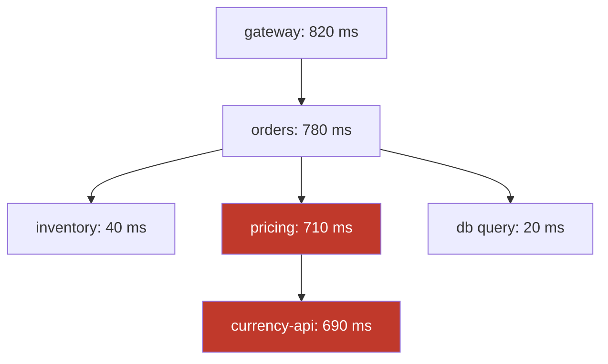

# Distributed Tracing

> Follow one request across every service it touched, when the logs are in twelve places.

**Group:** Operations

## What it is

Every request gets a trace id at the edge. That id is passed to every downstream call, and each service records spans: a name, a start time, a duration, and a parent. Assembled, the spans form a tree showing exactly where the time went and which call failed.

Metrics tell you that p99 latency is 3 seconds. Logs tell you what one service was doing. Tracing tells you that the 3 seconds was 2.8 seconds waiting on a single downstream call that nobody suspected.

## The failure it prevents

Debugging by correlation and guesswork. Without tracing, investigating a slow request in a system of fifteen services means opening fifteen log searches, matching on timestamps, and hoping. With services that call each other in varying orders, that method does not scale past a handful of services, and it fails entirely for problems that only occur for a small fraction of requests.

## How it works

Two mechanisms carry the whole pattern:

**Context propagation.** The trace id and the current span id travel in request headers. The W3C `traceparent` header is the standard, and using it means tools from different vendors interoperate. Propagation must cross every boundary: HTTP calls, message queues (put the header in message metadata), and background jobs. A boundary that drops the context breaks the trace into two disconnected pieces, and the gap is exactly where the bug usually is.

**Sampling.** Recording every span at high traffic is expensive in storage and in network. Two approaches:

- **Head sampling** decides at the start, keeping a fixed percentage. Cheap, simple, and it usually discards the rare failure you needed.
- **Tail sampling** buffers the whole trace and decides after it completes, keeping everything that errored or was slow plus a small sample of the rest. Far more useful, and it needs a collector holding spans in memory.

Use tail sampling if you can afford the collector. Keeping 100 percent of errors and 1 percent of successes is the shape most teams want.

## Knobs and typical numbers

| Knob | Typical starting value | Raise it when | Lower it when |
|---|---|---|---|
| Head sampling rate | 1 to 10% of requests | Low traffic, where you can afford everything | High traffic and storage cost |
| Tail sampling policy | 100% of errors, 100% of slow traces, 1 to 5% of the rest | Always the better default | Collector memory is constrained |
| Trace retention | 7 to 15 days | Investigations span weeks | Cost pressure |
| Spans per trace | Under 100 | Deep call trees are genuinely that deep | Instrumentation is too fine-grained |
| Added latency from instrumentation | Under 1% of request time | Never accept much more | Always measure it |

Instrument at the boundaries first: incoming requests, outgoing calls, database queries, and queue operations. That covers most of the value. Adding spans to internal functions comes later and rarely pays as well.

## Trade-offs

| You gain | You pay |
|---|---|
| The full path of one request, with timing per hop | Instrumentation in every service, and every boundary must propagate |
| Bottlenecks visible rather than inferred | Storage and collector cost that grows with traffic |
| Errors attributable to a specific hop | Sampling means the trace you want may not have been kept |
| A dependency map derived from reality, not from a wiki | Small but real latency and CPU overhead |

## Failure modes

- **Broken propagation.** One service does not forward the header, so every trace ends there. This is the most common problem and it hides exactly the part you need.
- **Async boundaries losing context.** A message published to a queue without trace headers disconnects the consumer's work from the request that caused it. Put the context in message metadata deliberately.
- **Head sampling discarding the failure.** The one request that failed was in the 99 percent not recorded. This is why tail sampling exists.
- **Traces without logs, or logs without trace ids.** Put the trace id in every log line. That single change makes logs and traces navigable together and costs almost nothing.
- **Over-instrumentation.** Ten thousand spans in one trace makes the tool slow and the trace unreadable. Instrument boundaries, not every function.
- **Sensitive data in span attributes.** Query parameters and request bodies often contain personal data, and traces are usually less protected than the primary datastore.
- **Clock skew across machines.** Spans appearing to start before their parent, or negative durations. Use monotonic clocks for duration and treat wall-clock ordering across hosts as approximate.

## What to instrument

- **Trace completeness**: the fraction of traces that reach the expected depth. A drop means propagation broke somewhere, usually after a deploy.
- **Span error rate per service and per operation**, which is what turns a trace store into a monitoring tool.
- **p99 duration per span name**, so a slow dependency is visible without opening individual traces.
- **Sampling decisions kept versus dropped**, so you know what your coverage actually is.
- **Instrumentation overhead**, measured by comparing an instrumented path with an uninstrumented one.
- Include the trace id in error responses so support tickets can carry it directly to the trace.

## Real systems that use it

- **Google Dapper** is the paper this all comes from, and it introduced sampling as a first-class part of the design rather than an afterthought.
- **OpenTelemetry** is now the vendor-neutral standard for instrumentation and propagation, and it is the right default choice because it avoids locking traces to one backend.
- **Jaeger, Zipkin, Grafana Tempo, Honeycomb, and Datadog** are the common backends. The instrumentation should be OpenTelemetry regardless of which you pick.

## Pairs with

- [Event-driven architecture](../communication/event-driven-architecture.md), where tracing is not optional because the flow is invisible otherwise.
- [Saga](../consistency/saga.md), whose multi-service flows are unusable to debug without a trace id.
- [Service mesh](../api-edge/service-mesh.md) and [sidecar](../api-edge/sidecar.md), which can inject and propagate headers but cannot connect spans inside a service.
- [Health check endpoint](https://github.com/design-gurus/grokking-system-design/blob/main/patterns/heartbeats.md), for the coarse signal that complements the detailed one.

## Go deeper

Covered lesson by lesson, with diagrams and honest trade-offs, in [System Design Patterns](https://www.designgurus.io/course/system-design-patterns?utm_source=github&utm_medium=repo&utm_campaign=design-patterns). For interview framing, see [grokking-system-design](https://github.com/design-gurus/grokking-system-design) and [Grokking the System Design Interview](https://www.designgurus.io/course/grokking-the-system-design-interview?utm_source=github&utm_medium=repo&utm_campaign=design-patterns).
