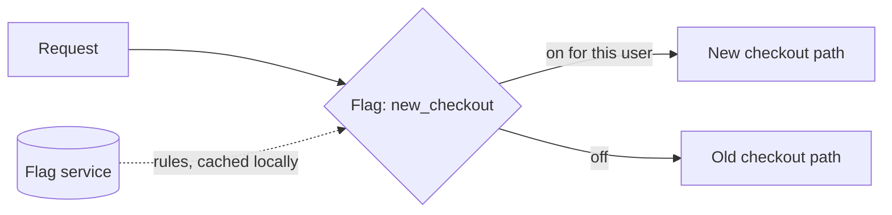

# Feature Flags

> Separate deploying code from releasing behavior, and accept the debt that follows.

**Group:** Operations
**Also called:** Feature toggles

## What it is

A runtime condition that decides whether a code path runs. The new checkout flow is deployed to production but reaches nobody until the flag is enabled, then 1 percent of users, then everyone. Turning it off does not require a deploy.

The reframing that makes flags useful: **a deploy and a release become different events**. Code ships continuously and dark. Behavior is turned on when the business is ready, and turned off in seconds when it is not.

## The failure it prevents

Long-lived branches, and rollbacks that require a deploy. Without flags, an unfinished feature lives on a branch for six weeks and the merge is a large, risky event. With flags, incomplete code merges to the main branch behind a flag that is off, and the merge is small and continuous.

The second prevention is incident response. When a new code path is causing errors at 02:00, turning off a flag takes seconds and needs no pipeline, no build, and no approval.

## How it works

Flags are not one thing. Four kinds, with very different lifetimes, and treating them as one category is where the mess starts:

| Kind | Purpose | Lifetime |
|---|---|---|
| Release | Hide unfinished work, then roll out | Days to weeks, then delete |
| Experiment | A/B test, measure a metric | The length of the experiment, then delete |
| Operational | Kill switch, load shedding, degrade a feature | Long-lived, deliberately permanent |
| Permission | Entitlements per plan or customer | Permanent, and arguably not a flag at all |

Only operational and permission flags are meant to live. Release and experiment flags that are not deleted are the source of every horror story about this pattern.

Evaluation must be **local and fast**. The flag service pushes rules to an in-process SDK that evaluates in microseconds with no network call, and serves a default if the service is unreachable. A flag check that makes a network call per request adds latency and a new dependency to every code path it guards.

## Knobs and typical numbers

| Knob | Typical starting value | Raise it when | Lower it when |
|---|---|---|---|
| Flag evaluation latency | Under 1 ms, in process | Never accept a network call per check | Always |
| Rule propagation delay | 1 to 30 seconds | Rarely | Kill switches need to be fast |
| Release flag lifetime | 2 to 4 weeks, then delete | A rollout is genuinely staged over months | Delete as soon as it is at 100% |
| Total active flags | Under 50 for a mid-size service | Rarely a good sign | Aggressively |
| Default when the flag service is down | The safe path, usually the old behavior | Always define it | Never leave it undefined |

Put an expiry date on every release and experiment flag at creation, and fail the build or open a ticket when it passes. Without automation, flag cleanup never happens, because it is nobody's priority and carries no visible reward.

## Trade-offs

| You gain | You pay |
|---|---|
| Turning a feature off in seconds, with no deploy | Every flag doubles the code paths, and they multiply |
| Trunk-based development, with small continuous merges | Testing all combinations becomes impossible past a few flags |
| Gradual rollout by percentage, region, or customer | Flag debt: dead flags nobody dares remove |
| A kill switch for incidents, and a lever for load shedding | A new runtime dependency in every guarded path |

## Failure modes

- **Flags that are never removed.** The defining failure. Every stale flag is a branch in the code and a question in every reader's mind. Knight Capital's 2012 loss of about 440 million dollars involved reusing an old flag whose meaning had changed on a system where the code behind it had not been fully retired. Treat cleanup as part of the feature, not as a follow-up.
- **Combinatorial explosion.** Ten flags is 1,024 possible states. Nobody tests that. Keep the number small and the flags independent.
- **Flags controlling data shape.** A flag that changes what gets written to the database is not reversible: turning it off leaves rows written in the new shape. Flags are safe for behavior and dangerous for persistence.
- **No default when the flag service fails.** The SDK cannot reach the service and the code path throws. Always define the offline default, and prefer the old behavior.
- **Inconsistent evaluation across services.** Two services evaluate the same flag differently for the same user, so a request sees the new checkout and the old pricing. Evaluate once at the edge and pass the decision down.
- **Flags used as configuration.** Timeouts and pool sizes are configuration, not flags. Mixing them makes both harder to reason about.
- **No audit trail.** Someone changed a flag and an incident started. Without a log of who changed what and when, that connection is guesswork.

## What to instrument

- **Flag age and count**, with a dashboard of flags past their expiry date. This is the metric that keeps debt under control.
- **Evaluation rate per flag**, which identifies flags nobody reads any more, and flags at 100 percent that could be removed.
- **Metrics split by flag state**, so error rate and latency for the on cohort can be compared with the off cohort. Without this, a flag rollout gives no evidence.
- **Flag change audit log**, with who, what, when, and why, correlated with incident timelines.
- **Fallback usage**, counting how often the offline default was served because the flag service was unreachable.

## Real systems that use it

- **Facebook's Gatekeeper** made continuous deployment with dark launches practical at scale, and is the origin of much of this practice.
- **LaunchDarkly, Unleash, and Flagsmith** are the common managed and open-source implementations, all built around local evaluation with pushed rules.
- **Chrome and Firefox** ship features behind flags for years, using them for both staged rollout and long-term opt-in experiments.

## Pairs with

- [Canary deployment](canary-deployment.md), which rolls out a binary. Flags roll out a behavior, and the two combine well.
- [Graceful degradation](../reliability/graceful-degradation.md), where an operational flag is the manual switch to shed a feature during an incident.
- [Blue-green deployment](blue-green-deployment.md), which flags reduce the need for, since most rollbacks become a flag change.
- [API versioning](../api-edge/api-versioning.md), for rolling out a behavior change to a subset of clients before it becomes the default.

## Go deeper

Covered lesson by lesson, with diagrams and honest trade-offs, in [System Design Patterns](https://www.designgurus.io/course/system-design-patterns?utm_source=github&utm_medium=repo&utm_campaign=design-patterns). For interview framing, see [grokking-system-design](https://github.com/design-gurus/grokking-system-design) and [Grokking the System Design Interview](https://www.designgurus.io/course/grokking-the-system-design-interview?utm_source=github&utm_medium=repo&utm_campaign=design-patterns).
