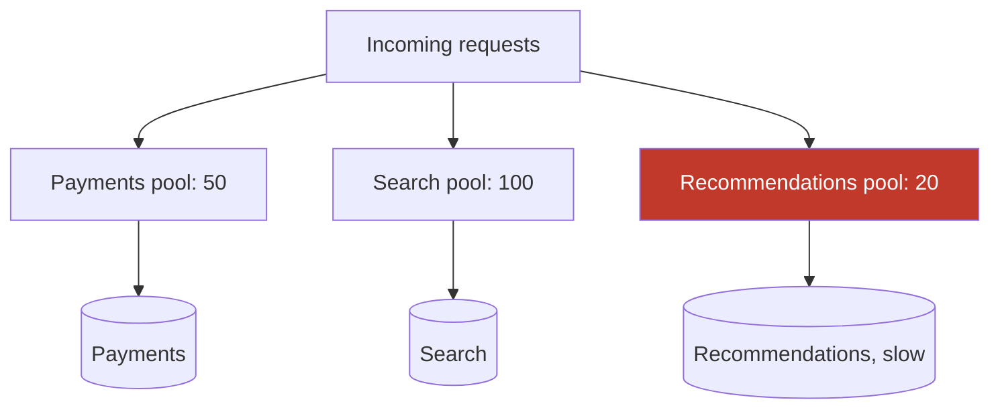

# Bulkhead

> Partition resources so one sick dependency cannot drown the whole service.

**Group:** Reliability

## What it is

A ship is divided into watertight compartments. A hull breach floods one compartment, and the ship stays afloat. In software, the compartments are pools: separate thread pools, connection pools, or concurrency limits, one per dependency or per class of work.

Without them, every dependency draws from one shared pool, and the slowest one takes all of it.

## The failure it prevents

Total failure caused by partial failure. A service has 200 worker threads and calls three dependencies. The recommendation service, which powers one optional widget, slows from 50 ms to 10 seconds. Requests touching it hold threads for 10 seconds each. Within a minute all 200 threads are waiting on recommendations, and checkout, search, and login all fail, none of which depend on it.

With a bulkhead capping recommendations at 20 threads, the widget degrades and everything else keeps working.

## How it works

When the recommendations pool is full, new calls to it are rejected immediately rather than queued. The rejection is the feature: the caller learns in microseconds that the widget is unavailable and renders the page without it. See [graceful degradation](graceful-degradation.md).

Two implementations, with different costs:

- **Thread pool isolation** gives real isolation, including protection from a dependency that blocks in native code. It costs a thread pool per dependency and a context switch per call.
- **Semaphore isolation** is a counter of in-flight calls. Nearly free, and it works only if the call actually respects its [timeout](timeout.md), because the caller's own thread is the one blocked.

Use semaphores by default. Use thread pools for dependencies you genuinely do not trust to return.

## Knobs and typical numbers

| Knob | Typical starting value | Raise it when | Lower it when |
|---|---|---|---|
| Pool size per dependency | Little's Law: throughput times p99 latency, plus about 20% headroom | Rejections happen while the dependency is healthy | The dependency is being overwhelmed by your concurrency |
| Queue depth in front of a pool | 0, or very small | Bursts are brief and queueing beats rejecting | A queue is just a slower way to fail, which is usually the case |
| Critical versus optional split | At least two pools: critical and optional | Never fewer | Never fewer |
| Rejection response time | Immediate, under 1 ms | Never | Never |

Little's Law is the sizing tool. A dependency handling 100 requests per second with a p99 of 200 ms needs about 100 times 0.2 equals 20 concurrent slots, so 25 with headroom. Sizing by guesswork produces pools that are either useless or a bottleneck.

## Trade-offs

| You gain | You pay |
|---|---|
| One failing dependency cannot exhaust the service | Total capacity is lower, because pools cannot lend to each other |
| Failures are fast and local rather than slow and global | More configuration, and each pool must be sized and revisited |
| Optional features degrade instead of taking the page down | Thread pool isolation adds context switches and memory |
| Blast radius is a design decision rather than an accident | A too-small pool rejects work while the dependency is fine |

## Failure modes

- **Pools sized by guesswork.** Too small and you reject healthy traffic. Too large and there is no isolation. Measure and use Little's Law.
- **A shared resource behind separate pools.** Three isolated thread pools all using one database connection pool means the database pool is the real bulkhead, and it is not partitioned.
- **Queueing instead of rejecting.** A deep queue in front of a full pool converts fast failure into slow failure, which is the thing you were trying to avoid.
- **Semaphore isolation with no timeout.** The counter never decrements because the calls never return. Semaphores only work with bounded calls.
- **No isolation for the database.** The most common gap. One expensive report query type can consume every connection. Give reporting its own pool, or its own replica.
- **Ignoring rejections.** A rejected call must be handled by the caller. Silently returning an empty list makes a dependency outage look like empty data.

## What to instrument

- **Pool utilization per dependency**, as a percentage. Sustained high utilization on a healthy dependency means the pool is too small.
- **Rejection count per pool**, which should be near zero in normal operation and should spike only when a dependency is genuinely sick.
- **Queue wait time**, if you have a queue at all.
- **Concurrent in-flight calls per dependency**, which is the input to Little's Law when you resize.
- Alert on rejections from a **critical** pool. Rejections from an optional pool are the system working as designed.

## Real systems that use it

- **Netflix Hystrix** popularized this pattern, with thread pool isolation per dependency, and its documentation is still the clearest explanation of the trade between thread pools and semaphores. It is now in maintenance, with **Resilience4j** the common successor.
- **Envoy** implements circuit breaking as per-upstream limits on connections, pending requests, and retries, which is bulkheading at the proxy layer.
- **Kubernetes resource requests and limits** are bulkheads for CPU and memory, keeping one noisy pod from starving its neighbors.

## Pairs with

- [Timeout](timeout.md), without which semaphore isolation does not work.
- [Circuit breaker](https://github.com/design-gurus/grokking-system-design/blob/main/patterns/circuit-breaker.md), which stops calling a dependency entirely once it is known bad. Bulkheads limit damage while the breaker decides.
- [Graceful degradation](graceful-degradation.md), which is what a caller should do when its bulkhead rejects.
- [Connection pooling](../scaling/connection-pooling.md), the pool most often left unpartitioned.

## Go deeper

Covered lesson by lesson, with diagrams and honest trade-offs, in [System Design Patterns](https://www.designgurus.io/course/system-design-patterns?utm_source=github&utm_medium=repo&utm_campaign=design-patterns). For interview framing, see [grokking-system-design](https://github.com/design-gurus/grokking-system-design) and [Grokking the System Design Interview](https://www.designgurus.io/course/grokking-the-system-design-interview?utm_source=github&utm_medium=repo&utm_campaign=design-patterns).
