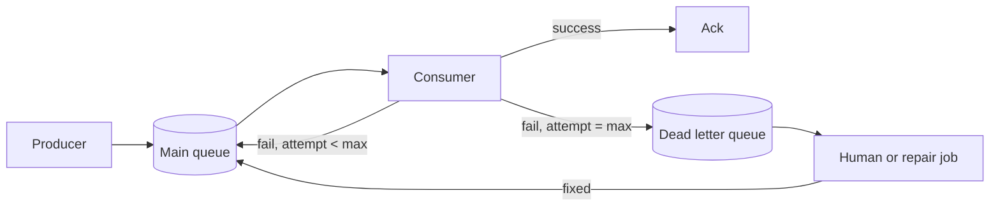

# Dead Letter Queue

> Somewhere to put the message that will never succeed, so the queue keeps moving.

**Group:** Reliability
**Also called:** DLQ, dead letter exchange, poison message queue

## What it is

A separate queue that receives messages which have failed processing too many times. After a configured number of attempts, the broker or the consumer moves the message out of the main queue and into the dead letter queue, along with the reason it failed.

Without one, a message that can never be processed is retried forever, and it blocks everything behind it.

## The failure it prevents

Head-of-line blocking by a poison message. One message has a malformed field that makes the consumer throw. The consumer retries, throws again, and the message returns to the front of the queue. It never succeeds and never leaves. Every message behind it waits, and a queue that was healthy an hour ago now has a backlog of two million.

The failure is worse than it looks, because throughput is zero while every dashboard shows the consumer running and processing attempts at a high rate.

## How it works

The message carries an attempt count. When it exceeds the limit, it goes to the dead letter queue instead of back to the main one. Critically, the dead letter message should carry **why**: the exception, the stack trace, the consumer version, and the original enqueue time. A dead letter queue full of payloads with no failure reason is an archive, not a debugging tool.

A dead letter queue is not a fix on its own. It is a place to put failures so that the rest of the system stays healthy, plus an obligation to look at what lands there.

## Knobs and typical numbers

| Knob | Typical starting value | Raise it when | Lower it when |
|---|---|---|---|
| Max receive count | 3 to 5 | Failures are usually transient and recoverable | Poison messages are common and should be quarantined fast |
| Visibility timeout | Longer than the p99 processing time | Processing is slow and messages are being redelivered while still in flight | Redelivery after a crash is too slow |
| Dead letter retention | 14 days | You need time to investigate | Storage or compliance limits |
| Alert threshold on depth | Greater than 0, for critical queues | The queue routinely gets a few and that is accepted | Never below caring |
| Redrive batch rate | Throttled, not all at once | Never dump the whole dead letter queue back at once | Always throttle |

Set the visibility timeout from measured processing time. If it is shorter than processing, the broker redelivers a message that is still being worked on, the work happens twice, and the attempt count climbs toward the dead letter queue for no reason.

## Trade-offs

| You gain | You pay |
|---|---|
| One bad message cannot stop the queue | A second queue to monitor, and failures that are now out of sight |
| Failed messages preserved for investigation, not lost | Someone has to actually look at it, or it becomes a silent graveyard |
| A safe place to fix and replay | Ordering is lost for the failed message relative to its siblings |
| The failure reason is captured at the moment it happened | Extra retention cost, and possibly sensitive data sitting longer |

## Failure modes

- **Nobody watches it.** The most common outcome. Messages accumulate for months and are found during an unrelated investigation. Alert on depth above zero for anything that matters.
- **No failure context stored.** The payload is there and the reason is not, so debugging means guessing or replaying against a debugger.
- **Redriving without fixing.** Sending everything back to the main queue while the bug is still present just repeats the cycle and doubles the noise.
- **Redriving everything at once.** Fifty thousand messages released into a queue sized for normal traffic knocks the consumer over. Throttle the redrive.
- **Ordering assumptions after recovery.** A message that spent an hour in the dead letter queue and is then replayed arrives after messages that logically follow it. Consumers must tolerate stale updates.
- **Using it to hide a systemic failure.** If 10 percent of messages dead letter, the design is wrong, not the messages.
- **Sensitive payloads with long retention.** A dead letter queue holding personal data for 14 days is a compliance question. Decide it before the audit does.

## What to instrument

- **Dead letter queue depth**, alerted above zero for critical queues.
- **Dead letter rate as a fraction of processed messages.** A rising fraction after a deploy means the deploy broke something.
- **Age of the oldest dead letter message**, which measures how long nobody has looked.
- **Failure reason grouped by exception type.** One dominant type is a bug to fix. Many types is usually a bad upstream.
- **Redelivery count distribution.** A spike in messages hitting attempt 2 or 3 without dead lettering is an early warning.

## Real systems that use it

- **Amazon SQS** implements this directly with a redrive policy: a max receive count and a target dead letter queue, plus a redrive action to send messages back.
- **RabbitMQ** uses dead letter exchanges, with messages routed there on rejection, expiry, or queue overflow.
- **Kafka** has no built-in dead letter queue, so the pattern is implemented by the consumer or by Kafka Connect's error-handling configuration, which is a common source of surprise for teams moving from SQS.

## Pairs with

- [Retry with exponential backoff](retry-exponential-backoff.md), which decides how many attempts happen before dead lettering.
- [Publish-subscribe](../communication/publish-subscribe.md), where each subscription needs its own dead letter queue.
- [Idempotency](https://github.com/design-gurus/grokking-system-design/blob/main/patterns/idempotency.md), because redriven messages are duplicates by definition.
- [Partitioned consumption](../data-intensive/partitioned-consumption.md), where a poison message blocks one partition rather than the whole topic.

## Go deeper

Covered lesson by lesson, with diagrams and honest trade-offs, in [System Design Patterns](https://www.designgurus.io/course/system-design-patterns?utm_source=github&utm_medium=repo&utm_campaign=design-patterns). For interview framing, see [grokking-system-design](https://github.com/design-gurus/grokking-system-design) and [Grokking the System Design Interview](https://www.designgurus.io/course/grokking-the-system-design-interview?utm_source=github&utm_medium=repo&utm_campaign=design-patterns).
