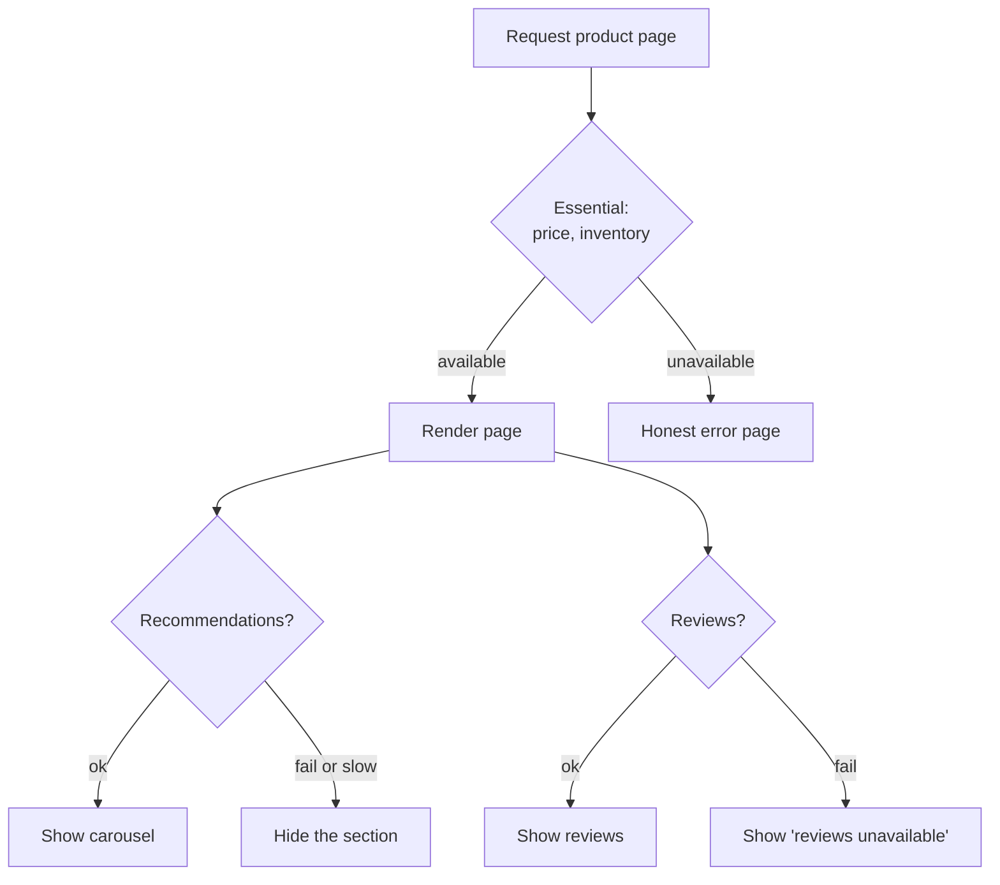

# Graceful Degradation

> Serve something useful when the ideal answer is not available.

**Group:** Reliability

## What it is

When a dependency fails, return a reduced but working response instead of an error. The product page renders without personalized recommendations. Search returns keyword results without the machine-learned ranking. The feed shows cached content from ten minutes ago.

The decision this pattern forces is one every system should make explicitly: **which parts of this response are essential, and which are enhancements?** Most teams never write that down, which is why one optional widget can take down a checkout page.

## The failure it prevents

Total failure from partial failure. A product page needs price, inventory, images, reviews, recommendations, and recently-viewed items. Six dependencies. If each is available 99.9 percent of the time and all six are required, the page is available about 99.4 percent of the time, which is over four hours of downtime a year caused entirely by composition.

If only price and inventory are required, the page's availability tracks those two, and the other four degrade quietly.

## How it works

Each optional dependency needs three things decided in advance: a **fallback value**, a **tighter timeout** than an essential call would get, and a **visible behavior** for the user. The fallback ladder in order of preference:

1. **Cached previous value.** Stale but real. Almost always the best fallback.
2. **A sensible static default.** Popular items instead of personalized ones.
3. **Hide the feature.** Better than a broken section.
4. **Show an honest placeholder.** "Reviews are temporarily unavailable" beats an empty box that looks like zero reviews.

The last one matters more than it seems. Silently returning empty is the failure mode that turns a dependency outage into a data-loss report from a customer.

## Knobs and typical numbers

| Knob | Typical starting value | Raise it when | Lower it when |
|---|---|---|---|
| Timeout on an optional call | 200 to 500 ms, well under the essential path | The feature is valuable and users will wait | The page must be fast regardless |
| Stale-cache fallback window | Minutes to hours, by data type | Staleness is harmless, as with recommendations | Prices, inventory, or anything money-related |
| Load-shed threshold | Shed optional work above roughly 80% capacity | You have headroom | You are protecting a hard latency target |
| Degradation levels | At least 2: full and essential-only | Complex products benefit from 3 | Never fewer than 2 |

Load shedding is graceful degradation applied to capacity rather than dependencies: above a utilization threshold, stop doing optional work for everyone, so essential work stays fast.

## Trade-offs

| You gain | You pay |
|---|---|
| Availability of the whole is not the product of its parts | Every optional dependency needs a designed fallback, which is real work |
| Failures are contained and often invisible to the user | Degraded paths are rarely tested and rot silently |
| Capacity can be redirected to what matters under load | Users may not know they are seeing a reduced experience |
| A forced, explicit conversation about what is essential | Business owners often disagree that their feature is optional |

## Failure modes

- **Silent empty results.** Returning `[]` when the reviews service is down looks identical to a product with no reviews. Distinguish "unknown" from "none", in the API and in the interface.
- **Degrading something essential.** Serving a stale price or stale inventory is not degradation, it is incorrect data with financial consequences. Some things must fail loudly.
- **Fallback paths that are never exercised.** The code has not run in eight months and no longer compiles against the current model. Test it, and run game days that turn dependencies off deliberately.
- **The fallback depending on the same thing.** A cache fallback that reads through to the same failing database is not a fallback.
- **No signal that degradation happened.** If nothing is logged or counted, you find out from a customer that recommendations have been off for a week.
- **Degradation that cascades.** Everyone falling back to the same cached default turns one dependency's outage into a stampede on the cache.

## What to instrument

- **Degradation rate per feature**, as its own metric. "Recommendations degraded on 4% of requests" is a real availability number.
- **Fallback source distribution**: live, stale cache, static default, hidden. Watch it shift.
- **Time spent degraded**, per feature, per day. This is what to review weekly.
- **Essential path availability**, tracked separately from overall. This is the number that should be on the service level objective.
- Alert on degradation exceeding a threshold, and on any degradation of an essential dependency at all.

## Real systems that use it

- **Netflix** designs the whole player experience around this: if personalization fails, you get non-personalized rows rather than an error, and their chaos engineering exists to keep those paths honest.
- **Google Search** drops expensive ranking features under load rather than slowing results, which is load shedding applied to relevance.
- **Amazon's product pages** compose many independent services, and sections disappear rather than blocking the buy button.

## Pairs with

- [Circuit breaker](https://github.com/design-gurus/grokking-system-design/blob/main/patterns/circuit-breaker.md), which decides when to stop calling and start falling back.
- [Bulkhead](bulkhead.md), which makes an optional dependency's failure fast and local.
- [Timeout](timeout.md), since a tight one is what turns "slow" into "degrade".
- [Cache-aside](../caching/cache-aside.md), which supplies the stale value that makes the best fallback possible.
- [Feature flags](../operations/feature-flags.md), which give an operator a manual switch to shed a feature during an incident.

## Go deeper

Covered lesson by lesson, with diagrams and honest trade-offs, in [System Design Patterns](https://www.designgurus.io/course/system-design-patterns?utm_source=github&utm_medium=repo&utm_campaign=design-patterns). For interview framing, see [grokking-system-design](https://github.com/design-gurus/grokking-system-design) and [Grokking the System Design Interview](https://www.designgurus.io/course/grokking-the-system-design-interview?utm_source=github&utm_medium=repo&utm_campaign=design-patterns).
