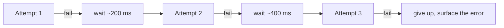

# Retry with Exponential Backoff

> Try again, waiting longer each time, with randomness, and with a budget. Every one of those four words is load-bearing.

**Group:** Reliability

## What it is

When a call fails in a way that might succeed on a second attempt, wait and try again. Each wait is longer than the last, and each wait includes a random component so that many clients do not retry in unison.

Retrying is the most tempting reliability pattern and the easiest one to turn into an outage. A naive retry loop is an amplifier pointed at a system that is already struggling.

## The failure it prevents

Transient failures reaching the user. Packet loss, a brief leader election, a pod restarting, a lock conflict, a rate limit: these fail once and succeed a moment later. Without retries, every one of them becomes a user-visible error.

What it must not do is convert a partial failure into a total one, which is what happens without backoff, jitter, and a budget.

## How it works

**Exponential backoff** doubles the base wait each attempt: 200 ms, 400 ms, 800 ms. This gives a struggling dependency room to recover instead of hammering it at a fixed interval.

**Jitter** is the part that gets skipped and matters most. Without it, a thousand clients that failed at the same instant all retry at the same instant, and the retry wave is as damaging as the original spike. The recommended form is full jitter: sleep a random duration between zero and the computed backoff. AWS published the analysis showing this beats both no jitter and half jitter.

**A retry budget** bounds total retry load. Rather than "3 attempts per request", cap retries as a fraction of overall traffic, typically 10 to 20 percent. When many requests fail at once, the budget is exhausted and retries stop, which is exactly the behavior you want during an incident.

**Retry only what is retryable.** A 400 will fail identically forever. Retry timeouts, connection failures, 429, 502, 503, 504. Do not retry 400, 401, 403, 404, or 422.

## Knobs and typical numbers

| Knob | Typical starting value | Raise it when | Lower it when |
|---|---|---|---|
| Base delay | 100 to 200 ms | The dependency needs longer to recover | The caller's deadline is tight |
| Multiplier | 2 | Rarely changed | Rarely changed |
| Max attempts | 3, including the first | Background work with a long deadline | User-facing calls, where 2 is often right |
| Max total retry time | Under the caller's remaining deadline | Never exceed it | Always derive it from the deadline |
| Jitter | Full jitter: random between 0 and the computed backoff | Always | Never disable it |
| Retry budget | 10% of request volume | Retries are cheap and dependencies are flaky | Retries are expensive |

Respect `Retry-After` when a server sends it. It is the dependency telling you exactly what it wants, and it beats any local calculation.

## Trade-offs

| You gain | You pay |
|---|---|
| Transient failures never reach the user | Latency grows for requests that fail and then succeed |
| Higher effective success rate with no extra infrastructure | Retries multiply load exactly when the system can least absorb it |
| Works with existing clients, no server changes | Every retried write needs idempotency, which is real work |
| Backoff gives a struggling dependency room | More attempts means more places a partial failure can occur |

## Failure modes

- **The retry storm.** Every layer retries three times. Four layers deep, one user request becomes 81 calls to the bottom service. Retry at **one** layer, usually the outermost that can act on the failure, and pass failures through elsewhere.
- **No jitter.** Synchronized clients produce a retry wave every backoff interval, so the dependency gets a periodic spike and never recovers.
- **Retrying non-retryable errors.** A validation error retried three times wastes three round trips and delays the error the user needed immediately.
- **Retrying non-idempotent writes.** The first attempt timed out but succeeded, and the retry charges the card again. Use an idempotency key.
- **Retries that outlive the deadline.** The caller gave up at 2 seconds and the retry chain runs for 6. Every attempt must check the remaining budget before starting.
- **Retrying through a circuit breaker that is open.** Wasted attempts against a dependency already known to be down.
- **Unbounded retries in background jobs.** A poison message retried forever occupies a worker permanently. Cap attempts and send it to a [dead letter queue](dead-letter-queue.md).

## What to instrument

- **Retry rate as a percentage of requests.** This is the number that tells you whether retries are amplifying load.
- **Attempts per successful request**, at p50 and p99. A p99 of 3 means most of your tail latency is retry waiting.
- **Success rate by attempt number.** If attempt 3 almost never succeeds, three attempts is one too many.
- **Retry budget exhaustion events**, which mean the system chose to stop amplifying. That is healthy, and it should be visible.
- **Errors classified retryable versus not**, so you can catch a class being retried that should not be.

## Real systems that use it

- **The AWS SDKs** implement full jitter with a retry budget by default, following their own published analysis of exponential backoff and jitter.
- **Kubernetes** uses exponential backoff with a cap for pod restarts (`CrashLoopBackOff`), which is the same idea applied to process supervision.
- **gRPC** supports retry policies with backoff and a retry throttle configured per service, so the policy lives in configuration rather than in every client.

## Pairs with

- [Timeout](timeout.md), which must exist first. Retrying a call with no bound multiplies an unbounded wait.
- [Idempotency](https://github.com/design-gurus/grokking-system-design/blob/main/patterns/idempotency.md), required for any retried write.
- [Circuit breaker](https://github.com/design-gurus/grokking-system-design/blob/main/patterns/circuit-breaker.md), which stops retries when the dependency is already down.
- [Dead letter queue](dead-letter-queue.md), for the messages that exhaust their attempts.

## Go deeper

Covered lesson by lesson, with diagrams and honest trade-offs, in [System Design Patterns](https://www.designgurus.io/course/system-design-patterns?utm_source=github&utm_medium=repo&utm_campaign=design-patterns). For interview framing, see [grokking-system-design](https://github.com/design-gurus/grokking-system-design) and [Grokking the System Design Interview](https://www.designgurus.io/course/grokking-the-system-design-interview?utm_source=github&utm_medium=repo&utm_campaign=design-patterns).
