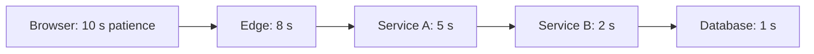

# Timeout

> A bound on how long you are willing to be stuck. The cheapest reliability pattern, and the one most often left at its default.

**Group:** Reliability

## What it is

A limit on how long a call may take before the caller gives up and handles the failure. It applies to HTTP calls, database queries, lock acquisition, and anything else that waits.

The default in most libraries is infinite, or a value like 30 seconds that was chosen for a very different situation. That default is the source of a large share of production incidents, because a call that never returns holds a thread forever, and threads are what you run out of first.

## The failure it prevents

Resource exhaustion propagating upward. A downstream service slows from 40 ms to 20 seconds. It has not failed, so nothing alerts. Your callers keep sending traffic, each request holds a thread while waiting, and within a minute the thread pool is full. Now every endpoint on your service fails, including the ones with no dependency on the slow service.

Slow is worse than down. A service that is down returns an error in a millisecond and frees the thread. A service that is slow holds your resources hostage.

## How it works

Each layer's timeout must be shorter than the timeout of the layer that called it. If the database query is allowed 3 seconds but Service B gives up at 2, the query keeps running after nobody wants the answer, holding a connection and possibly a lock.

The stronger version of this is a **deadline**, not a timeout. A timeout is per hop and resets at each one, so five hops with 2-second timeouts allow 10 seconds. A deadline is an absolute instant passed along with the request, so every hop knows how much of the budget remains and can refuse to start work that cannot finish in time. gRPC and Go's `context` both do this, and it is the better model.

Timeouts need at least two settings per call:

- **Connection timeout**: how long to wait to establish a connection. Short, because a healthy connection is fast.
- **Read or overall timeout**: how long to wait for the response once connected. Sized to the work.

## Knobs and typical numbers

| Knob | Typical starting value | Raise it when | Lower it when |
|---|---|---|---|
| Connection timeout | 100 to 500 ms in one region | Cross-region or cross-cloud calls | Everything is in one availability zone |
| Read timeout, user-facing call | 1 to 3 seconds | The user expects to wait, and you show them that | The caller has a tighter deadline |
| Read timeout, background job | 10 to 60 seconds | Genuinely long work | The job must yield to others |
| Database query timeout | 1 to 5 seconds for transactional queries | Reporting queries, which belong on a replica anyway | Lock contention is the concern |
| Lock acquisition timeout | 50 to 500 ms | Contention is expected and waiting beats failing | Failing fast is better than queueing |

Derive the value from the measured p99, not from a guess. A timeout at roughly the p99.9 of a healthy period catches real failures without cutting off slow-but-working requests. Setting it at p50 turns normal variance into errors.

## Trade-offs

| You gain | You pay |
|---|---|
| Bounded resource use per call | A timeout that is too tight turns healthy slowness into failures |
| Failures surface fast, where they can be handled | You never learn whether the work actually completed |
| One slow dependency stops cascading | Every call site needs a considered value, not a default |
| A precondition for retries and circuit breakers | Tuning is ongoing, because p99 drifts as the system changes |

## Failure modes

- **The infinite default.** Many HTTP clients wait forever out of the box. This is the single most common version of this bug.
- **Timeouts that grow inward.** Service A waits 2 seconds, Service B waits 5. A gives up first, B keeps working, and the work is wasted. Check the chain end to end.
- **A timeout without idempotency.** A write timed out. Did it happen? You do not know. Retrying without [idempotency](https://github.com/design-gurus/grokking-system-design/blob/main/patterns/idempotency.md) can double-charge a customer.
- **Cancellation that does not propagate.** The caller gives up but the downstream keeps running, holding the connection, the transaction, and the lock. Propagate cancellation, and make long handlers check for it.
- **One timeout for every call.** A cheap key lookup and a report generation do not deserve the same budget. Per-dependency values, at minimum.
- **Timeout tuned during an incident and never revisited.** The temporary 30 seconds becomes permanent and hides the next problem.

## What to instrument

- **Timeout rate as a separate metric from error rate.** Rising timeouts are the earliest signal that a dependency is degrading.
- **Latency at p99 and p99.9 per dependency**, which is what timeout values must be derived from.
- **Thread pool or connection pool saturation**, the resource timeouts exist to protect.
- **Time-remaining on the deadline when work starts**, if you use deadline propagation. Work starting with 5 ms left should be refused, not attempted.
- Alert on timeout rate crossing a small threshold, well before saturation.

## Real systems that use it

- **gRPC** makes deadlines a first-class part of the call, propagated across hops, which is why gRPC services tend to handle slow dependencies better than plain HTTP ones.
- **Go's `context.Context`** carries a deadline and a cancellation signal through the whole call tree, and idiomatic Go passes it to every blocking operation.
- **Envoy and other service proxies** enforce timeouts at the network layer, so a service with a badly configured client still gets a bound.

## Pairs with

- [Retry with exponential backoff](retry-exponential-backoff.md), which is only safe once calls are bounded.
- [Circuit breaker](https://github.com/design-gurus/grokking-system-design/blob/main/patterns/circuit-breaker.md), which uses timeouts as its failure signal.
- [Bulkhead](bulkhead.md), which limits the blast radius when timeouts are too long.
- [Idempotency](https://github.com/design-gurus/grokking-system-design/blob/main/patterns/idempotency.md), required before any timed-out write can be retried.

## Go deeper

Covered lesson by lesson, with diagrams and honest trade-offs, in [System Design Patterns](https://www.designgurus.io/course/system-design-patterns?utm_source=github&utm_medium=repo&utm_campaign=design-patterns). For interview framing, see [grokking-system-design](https://github.com/design-gurus/grokking-system-design) and [Grokking the System Design Interview](https://www.designgurus.io/course/grokking-the-system-design-interview?utm_source=github&utm_medium=repo&utm_campaign=design-patterns).
