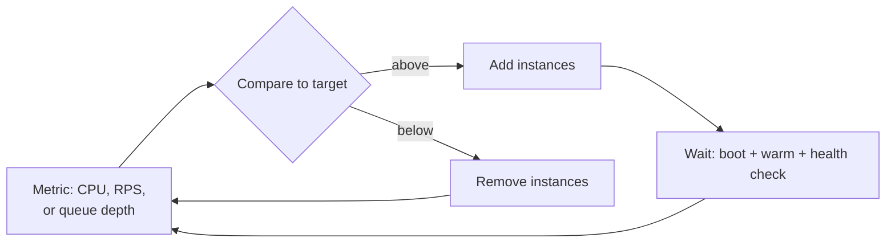

# Auto-Scaling

> Match capacity to load automatically. The lag between the two is the whole problem.

**Group:** Scaling

## What it is

A controller watches a metric, compares it to a target, and adds or removes instances. More load, more instances. Less load, fewer instances, and a smaller bill.

The idea is simple. What makes it hard is that scaling is not instant, so the system is always responding to load that has already arrived.

## The failure it prevents

Paying for peak capacity all the time, or being unable to serve peak at all. A service sized for Black Friday wastes most of its capacity in February. A service sized for February fails in November.

What it does **not** prevent is a sudden spike. If load doubles in ten seconds and instances take two minutes to become healthy, auto-scaling arrives after the incident. For that case you need headroom or a queue, not a scaling policy.

## How it works

The loop has real delay at every step: metric collection (up to a minute), the controller's evaluation period, instance boot, application warm-up, and health checks. Two to five minutes end to end is normal, and it is the number that decides whether auto-scaling can help with your traffic shape.

Three ways to trigger, and the third is usually best:

- **Reactive on a resource metric** (CPU, memory). Simple, and it lags the most.
- **Reactive on a work metric** (requests per second, queue depth). Better, because it tracks the actual demand rather than a symptom.
- **Scheduled**, ahead of predictable events. Cheapest and most reliable for known patterns: business hours, a marketing email, a scheduled sale.

Scheduled plus reactive is the combination that works. Pre-scale for what you can predict, react to what you cannot.

## Knobs and typical numbers

| Knob | Typical starting value | Raise it when | Lower it when |
|---|---|---|---|
| Target metric value | 50 to 70% CPU, or a queue depth in seconds of work | Startup is fast and traffic is smooth | Startup is slow, or spikes are sharp |
| Scale-out cooldown | 60 to 180 seconds | Instances take a long time to warm | You need fast response and can tolerate some flapping |
| Scale-in cooldown | 5 to 15 minutes, much longer than scale-out | Traffic is choppy | Cost pressure is high and traffic is genuinely stable |
| Scale-out step | Aggressive: add 30 to 50% or a fixed batch | Spikes are common | Downstream limits |
| Scale-in step | Conservative: one instance at a time | Never aggressive | Never aggressive |
| Minimum instances | Enough to survive a zone loss, usually 3 | Availability targets are strict | Never below 2 |

The asymmetry is the point: **scale out fast, scale in slowly.** Adding an instance you did not need costs a few cents. Removing one you did need costs an incident.

## Trade-offs

| You gain | You pay |
|---|---|
| Cost tracks demand instead of tracking peak | A control loop with delay, which can oscillate or arrive late |
| Capacity for growth without manual intervention | Scaling amplifies load on downstream systems that cannot scale |
| Automatic replacement of unhealthy instances | Tuning is ongoing and easy to get subtly wrong |
| Handles predictable daily and weekly cycles well | Useless against spikes faster than the scaling loop |

## Failure modes

- **Scaling the stateless tier into a database wall.** Instance count triples, connection count triples, and the database refuses connections. The application tier is now scaled and the system is more broken than before. Cap max instances at what the downstream can absorb, and use a connection pooler.
- **Flapping.** Scale-in cooldown too short, so the controller adds and removes instances repeatedly, and every removal drops warm caches and in-flight work. Long scale-in cooldown fixes it.
- **Scaling on the wrong metric.** CPU stays flat while a service waits on I/O, so a saturated service never scales. Scale on queue depth or concurrency for I/O-bound work.
- **Startup too slow to matter.** Four minutes of warm-up means the policy responds to a spike that ended three minutes ago. Fix startup time first; it is usually the highest-leverage change.
- **No maximum, meeting a bug.** A retry storm or an infinite loop scales to hundreds of instances and produces a memorable invoice. Always set a maximum and alert when it is reached.
- **Health checks that pass before the instance is ready.** Traffic arrives at an instance with cold caches and unwarmed connection pools, and those requests are slow or fail. Readiness must mean ready.
- **Scale-in dropping in-flight work.** Without connection draining and a graceful shutdown period, removing an instance kills live requests.

## What to instrument

- **Scaling events with their trigger and resulting instance count**, on the same dashboard as latency and error rate. Most scaling misconfiguration is visible only in that overlay.
- **Time from metric breach to healthy instance**, measured end to end. This is the reaction time, and everything depends on it.
- **Instance startup duration**, broken into boot, warm-up, and first healthy check.
- **Requests served during scale-in**, which should show zero failures.
- **Distance to max instances**, alerted before it is reached.
- **Cost per request over time**, which is how you tell whether the policy is doing its job.

## Real systems that use it

- **Kubernetes Horizontal Pod Autoscaler** scales on CPU, memory, or custom metrics, and KEDA extends it to queue depth, which is usually the better signal for workers.
- **AWS Auto Scaling groups with target tracking** implement the metric-and-target loop directly, and their documentation is explicit about the asymmetric cooldown advice.
- **Serverless platforms** such as Lambda and Cloud Run scale per request with near-zero reaction time, which removes the lag problem and replaces it with cold starts and concurrency limits.

## Pairs with

- [Horizontal scaling](horizontal-scaling.md), which is the precondition: statelessness must come first.
- [Connection pooling](connection-pooling.md), which decides how far you can scale before the database says no.
- [Health check endpoint](https://github.com/design-gurus/grokking-system-design/blob/main/patterns/heartbeats.md), which defines when a new instance may take traffic.
- [Graceful degradation](../reliability/graceful-degradation.md) and [rate limiting](https://github.com/design-gurus/grokking-system-design/blob/main/patterns/rate-limiting.md), for spikes faster than the scaling loop.
- [GPU auto-scaling](../ai-systems/gpu-autoscaling.md), the same pattern where cold start is measured in minutes and every instance is expensive.

## Go deeper

Covered lesson by lesson, with diagrams and honest trade-offs, in [System Design Patterns](https://www.designgurus.io/course/system-design-patterns?utm_source=github&utm_medium=repo&utm_campaign=design-patterns). For interview framing, see [grokking-system-design](https://github.com/design-gurus/grokking-system-design) and [Grokking the System Design Interview](https://www.designgurus.io/course/grokking-the-system-design-interview?utm_source=github&utm_medium=repo&utm_campaign=design-patterns).
