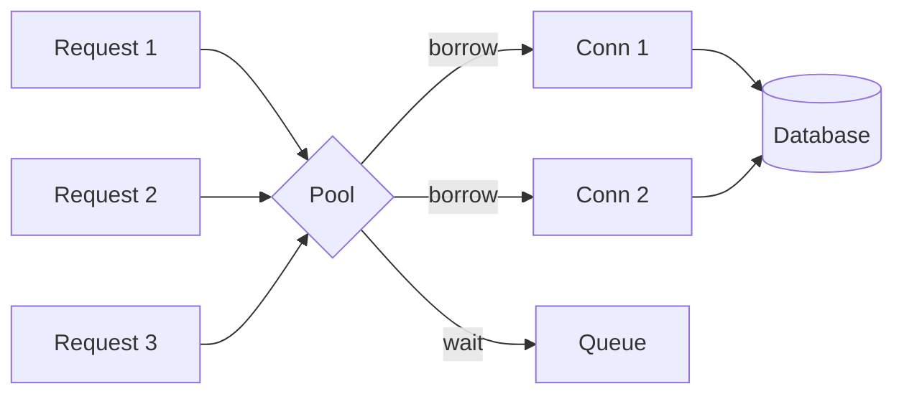

# Connection Pooling

> Reuse connections instead of opening one per request, and stop the database running out of them.

**Group:** Scaling

## What it is

A pool of already-open connections that requests borrow and return. Opening a database connection costs a TCP handshake, a TLS handshake, and authentication, which is milliseconds of latency and real work on the server. Doing that per request wastes both.

The second reason matters more at scale: databases have a hard connection limit, and each connection costs memory on the server whether it is busy or idle.

## The failure it prevents

Connection exhaustion, which presents as total failure rather than slowness. Postgres defaults to 100 connections and allocates a backend process per connection. Forty application instances with a pool of 20 each want 800. The database refuses new connections, every instance fails at once, and the error looks like the database is down.

The counterintuitive part: **more connections usually means less throughput.** Past the point where the database can keep its cores busy, additional connections add context switching and lock contention. A pool of 200 often performs worse than a pool of 20.

## How it works

A request borrows a connection, runs its query, and returns it. When all connections are busy, the next request waits in a queue until one frees or its timeout expires. That queue is the pool doing its job: it converts unbounded concurrency into bounded concurrency, which is what protects the database.

At high instance counts, an **external pooler** sits between the application and the database and multiplexes many client connections onto few server connections. PgBouncer in transaction mode is the standard answer for Postgres, and it is what makes a large horizontally scaled fleet possible.

## Knobs and typical numbers

| Knob | Typical starting value | Raise it when | Lower it when |
|---|---|---|---|
| Pool size per instance | Small: 5 to 20 | Measured pool wait time is high while the database is idle | The database shows contention or high context-switch rates |
| Total connections across the fleet | Under 60 to 80% of the database limit | Never above it | Approaching the limit |
| Connection acquire timeout | 1 to 5 seconds | Bursts are brief | Failing fast is better than queueing |
| Max connection lifetime | 15 to 30 minutes | Rarely | Load balancers or proxies cut idle connections sooner |
| Idle timeout | 5 to 10 minutes | Traffic is steady | Connections are expensive on the server |
| Validation query on borrow | Cheap check, or rely on lifetime | Network drops connections silently | Validation cost is measurable |

A useful starting formula for a transactional database is roughly `cores * 2 + effective spindles`, which for a modern 8-core server lands near 20 total, not 20 per instance. HikariCP's documentation makes this argument well, and it surprises most teams.

The arithmetic that matters: **pool size times instance count must stay under the database limit**, with headroom for administrative connections and for a deploy that briefly runs two versions.

## Trade-offs

| You gain | You pay |
|---|---|
| No handshake cost per request | A fixed number of connections held even when idle |
| Bounded concurrency protecting the database | A queue that adds latency when the pool is exhausted |
| A natural place to enforce a per-service limit | Another component to size, and sizing it wrong fails badly |
| Predictable behavior under load | Pool state is per instance, so the fleet total is easy to lose track of |

## Failure modes

- **Pool size multiplied by instance count exceeding the database limit.** The classic. Nothing in the application warns you, and it appears the first time auto-scaling adds instances.
- **Pools that are too large.** Throughput falls, latency rises, and the instinct is to raise the pool further, which makes it worse. Measure before increasing.
- **Connection leaks.** A code path that borrows and never returns, usually a missing close in an error branch. The pool drains slowly and the service dies hours after the deploy.
- **Long transactions holding connections.** A request that opens a transaction, calls an external API, and then commits holds a connection for the whole external call. Never do I/O to a third party inside a transaction.
- **Transaction-mode poolers with session state.** PgBouncer in transaction mode breaks prepared statements, session variables, advisory locks, and `LISTEN`. The application must be written for it.
- **No acquire timeout.** Requests queue forever, threads pile up, and the service exhausts itself waiting for the database.
- **Ignoring the pool on scale-in and scale-out.** Auto-scaling changes the fleet total continuously, so the limit must be checked against maximum instances, not current ones.

## What to instrument

- **Pool wait time at p99.** Near zero means the pool is big enough. Anything else means requests are queueing.
- **Active versus idle connections per instance**, and the fleet total against the database limit. This aggregate is the metric teams most often lack.
- **Connection acquire timeouts**, which should be zero.
- **Connection lifetime and creation rate.** A high creation rate means connections are churning rather than being reused.
- **Longest-held connection duration**, which catches leaks and long transactions.
- Alert on fleet connections crossing 80 percent of the database limit.

## Real systems that use it

- **HikariCP** is the default in Spring Boot and its documentation argues for small pools with the benchmark data to support it.
- **PgBouncer** is the standard external pooler for Postgres, and transaction pooling is what lets hundreds of application instances share a database that allows a few hundred connections.
- **Serverless platforms** broke this pattern initially, because each function instance opened its own connection. That is why proxies such as the AWS RDS Proxy and Data API exist.

## Pairs with

- [Horizontal scaling](horizontal-scaling.md), which multiplies pools and is the reason the fleet total matters.
- [Auto-scaling](auto-scaling.md), whose maximum instance count must be checked against the database limit.
- [Bulkhead](../reliability/bulkhead.md), since separate pools per workload keep reporting queries from starving transactional ones.
- [Timeout](../reliability/timeout.md), which the acquire timeout is a specific instance of.

## Go deeper

Covered lesson by lesson, with diagrams and honest trade-offs, in [System Design Patterns](https://www.designgurus.io/course/system-design-patterns?utm_source=github&utm_medium=repo&utm_campaign=design-patterns). For interview framing, see [grokking-system-design](https://github.com/design-gurus/grokking-system-design) and [Grokking the System Design Interview](https://www.designgurus.io/course/grokking-the-system-design-interview?utm_source=github&utm_medium=repo&utm_campaign=design-patterns).
