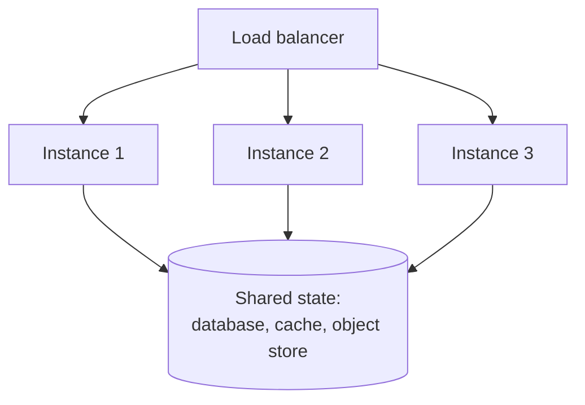

# Horizontal Scaling

> More machines, which forces you to deal with state.

**Group:** Scaling
**Also called:** Scaling out

## What it is

Handle more load by adding more instances and spreading requests across them. Capacity becomes roughly a function of instance count, and failure of any single instance stops being fatal.

The pattern is simple to state and the whole difficulty is one word: **state**. Anything an instance remembers between requests has to move somewhere shared, or the instances disagree.

## The failure it prevents

The single-machine ceiling and the single failure domain. [Vertical scaling](vertical-scaling.md) eventually runs out of instance sizes, and however large the machine, losing it loses everything. Horizontal scaling removes both limits, at the cost of every problem in distributed systems.

## How it works

The requirement is **statelessness**: any instance can serve any request, because nothing important lives in an instance's memory or local disk. Four things usually need moving:

| Local state | Where it goes |
|---|---|
| Session data | Shared cache or a signed token held by the client |
| Uploaded files | Object storage |
| In-memory cache | A shared cache, or accept per-instance duplication |
| Scheduled jobs | A leader-elected runner, or a scheduler with locking |

That last row causes more incidents than the others. A cron job inside an application that is scaled to twelve instances now runs twelve times.

Sticky sessions, where the load balancer pins a user to one instance, are the shortcut that avoids the work. They also break rolling deploys, make scale-down lossy, and produce uneven load. Treat them as a temporary measure with a removal date.

## Knobs and typical numbers

| Knob | Typical starting value | Raise it when | Lower it when |
|---|---|---|---|
| Minimum instances | 3, spread across availability zones | You need to survive losing a zone at peak | Never below 2 for anything that matters |
| Target utilization | 50 to 70% of capacity | Scaling reacts quickly and traffic is smooth | Traffic is spiky, or startup is slow |
| Instance startup time | Under 60 seconds to healthy | Never higher if you can help it | Faster is always better for scaling and deploys |
| Graceful shutdown period | 30 to 60 seconds | Requests are long-running | Requests are short |
| Max instances | 2 to 3 times peak need | Growth is unpredictable | Downstream limits, especially the database |

N+2 across zones is the usual availability starting point: enough capacity that losing one zone still leaves headroom.

## Trade-offs

| You gain | You pay |
|---|---|
| Capacity that grows roughly with instance count | Every piece of local state must move to shared storage |
| Failure of one instance is routine, not an outage | Shared state becomes the new bottleneck and the new failure domain |
| Rolling deploys and zero-downtime releases become possible | Debugging spans machines, so logging and tracing must be centralized |
| Cost tracks demand when combined with auto-scaling | Coordination problems appear: scheduled jobs, caches, connection counts |

## Failure modes

- **The database becomes the bottleneck.** Twenty stateless instances all query one primary. You moved the constraint rather than removing it. This is the normal outcome and the reason [connection pooling](connection-pooling.md), read replicas, and caching matter here.
- **Connection multiplication.** Each instance opens a pool of 20 connections. Three instances is 60. Forty instances is 800, and the database refuses new connections. Pool sizes must be divided by instance count, or you need an external pooler.
- **Duplicated scheduled jobs.** The nightly billing run executes once per instance. Use leader election or a scheduler with a distributed lock.
- **Sticky sessions treated as permanent.** Scale-down drops sessions, deploys log users out, and load is uneven because heavy users are pinned.
- **Local caches diverging.** Each instance caches independently, so users see different answers depending on routing. Acceptable for some data, alarming for the rest. Decide which.
- **Slow startup defeating the point.** An instance that takes four minutes to become healthy cannot respond to a traffic spike.
- **Uneven distribution.** Long-lived connections pin traffic to the instances that were up when clients connected, so new instances stay idle after a scale-out.

## What to instrument

- **Per-instance utilization variance.** Instances should look alike. One hot instance means routing or state is uneven.
- **Total downstream connections**, aggregated across instances, compared to the database's limit. This is the number that surprises teams.
- **Instance startup to healthy time**, which bounds how fast you can react to anything.
- **Requests dropped during scale-down or deploy**, which should be zero with correct draining.
- **Cost per request against instance count**, to see when scaling stops being linear.

## Real systems that use it

- **The Twelve-Factor App** codified statelessness as a precondition for this pattern, and it remains the clearest statement of the required discipline.
- **Kubernetes Deployments** are horizontal scaling as an API: replica count, readiness probes, and rolling updates in one object.
- **Netflix** runs stateless services across zones with automatic instance replacement, and their chaos tooling exists to keep the "any instance can die" assumption true.

## Pairs with

- [Load balancing](https://github.com/design-gurus/grokking-system-design/blob/main/patterns/load-balancing.md), which is required to distribute the traffic.
- [Auto-scaling](auto-scaling.md), which decides the instance count automatically.
- [Connection pooling](connection-pooling.md), which becomes critical rather than optional once instance count grows.
- [Sharding](https://github.com/design-gurus/grokking-system-design/blob/main/patterns/sharding-partitioning.md), for scaling the shared state that this pattern pushes load onto.
- [Health check endpoint](https://github.com/design-gurus/grokking-system-design/blob/main/patterns/heartbeats.md), which tells the load balancer which instances can serve.

## Go deeper

Covered lesson by lesson, with diagrams and honest trade-offs, in [System Design Patterns](https://www.designgurus.io/course/system-design-patterns?utm_source=github&utm_medium=repo&utm_campaign=design-patterns). For interview framing, see [grokking-system-design](https://github.com/design-gurus/grokking-system-design) and [Grokking the System Design Interview](https://www.designgurus.io/course/grokking-the-system-design-interview?utm_source=github&utm_medium=repo&utm_campaign=design-patterns).
