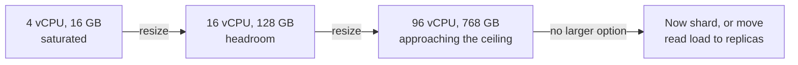

# Vertical Scaling

> Get a bigger machine. Underrated, and it runs out.

**Group:** Scaling
**Also called:** Scaling up

## What it is

Handle more load by giving one machine more CPU, memory, disk throughput, or network bandwidth. No sharding, no distributed coordination, no changes to the application.

It has a reputation as the unsophisticated option. That reputation costs teams a great deal of engineering time, because modern machines are enormous and most systems never need more than one.

## The failure it prevents

Premature distribution. Splitting a database into shards or a service into partitions introduces distributed transactions, cross-shard queries, rebalancing, and a class of bugs that do not exist on one machine. If a larger instance would carry the load for another two years, taking on that complexity now buys nothing and costs a great deal.

## How it works

The practical ceiling is high. Cloud providers offer instances with hundreds of vCPUs and multiple terabytes of memory. A single well-tuned Postgres instance on modern hardware handles tens of thousands of transactions per second, and many production databases serving millions of users run on one primary.

The real limits are three:

1. **The largest instance available.** A hard stop, and it moves upward every year.
2. **Single point of failure.** One machine is one failure domain, so this pattern needs a replica for availability even when it does not need one for capacity.
3. **Downtime to resize.** Usually a restart, so a maintenance window or a failover.

## Knobs and typical numbers

| Knob | Typical starting value | Raise it when | Lower it when |
|---|---|---|---|
| Target CPU utilization | 50 to 70% at peak | You have fast horizontal capacity to fall back on | Traffic is spiky and you need burst headroom |
| Memory headroom | 30% free at peak | Workload has large transient allocations | Steady, predictable memory use |
| Resize trigger | Sustained peak above 70% | Never sustained above 85% | Cost pressure with genuinely flat load |
| Connection limit | Scale with memory, not cores | Many idle connections | Connections are pooled properly |
| Time to plan the next step | Start planning at 60% of the largest available instance | Growth is slow | Growth is fast, so start earlier |

The number worth tracking: **months of headroom left**, computed from the growth rate and the largest instance available. That is the metric that tells you when to start the horizontal work, and it should be reviewed quarterly rather than discovered during an incident.

## Trade-offs

| You gain | You pay |
|---|---|
| No application changes, no distributed systems problems | A hard ceiling, and it arrives without warning if unwatched |
| Strong consistency stays free, transactions stay simple | One failure domain, so a replica is still required |
| Debugging stays tractable: one machine, one set of logs | Cost grows faster than linearly at the top of the range |
| Immediate relief, often within one maintenance window | Resizing usually needs a restart or a failover |

## Failure modes

- **Scaling up a bottleneck that is not CPU or memory.** A workload limited by disk IOPS or by a single-threaded lock does not improve with more cores. Profile before resizing, or you pay for capacity that changes nothing.
- **Assuming linear returns.** Doubling cores rarely doubles throughput. Contention, memory bandwidth, and lock convoys mean the second half of a big instance often delivers much less than the first.
- **Ignoring the ceiling until it arrives.** Sharding under pressure, with a saturated database, is the worst possible time to do it. Start the work while there is headroom.
- **Forgetting the failure domain.** A very large single instance with no replica is a very large outage.
- **Not resizing connection limits and pool sizes with the instance.** A bigger machine with the old settings performs like the smaller one.
- **Vertical scaling as a permanent answer to a code problem.** An N+1 query pattern will consume any instance you buy.

## What to instrument

- **CPU, memory, disk IOPS, and network throughput as a set.** Whichever saturates first is the real constraint.
- **Headroom to the largest available instance**, expressed in months at current growth. This is the planning metric.
- **Cost per request**, which reveals when the top of the instance range stops being economical.
- **Saturation, not just utilization**: run queue depth, disk queue depth, and swap activity. These show the machine struggling before averages do.
- **Failover time**, measured, not assumed, since availability depends on it entirely.

## Real systems that use it

- **Stack Overflow** famously served very large traffic from a small number of large servers, publishing their architecture as an argument that vertical scaling plus careful engineering beats premature distribution.
- **Shopify and GitHub** both ran single very large primary databases for years before sharding, and both wrote about doing the horizontal work deliberately rather than reactively.
- **Cloud managed databases** make this a configuration change, which is why the pattern is more attractive now than it was a decade ago.

## Pairs with

- [Horizontal scaling](horizontal-scaling.md), the next step, and the one that needs planning before the ceiling arrives.
- [Primary-replica](https://github.com/design-gurus/grokking-system-design/blob/main/patterns/replication.md), which vertical scaling still requires for availability and read capacity.
- [Connection pooling](connection-pooling.md), which must be retuned after every resize.
- [Sharding](https://github.com/design-gurus/grokking-system-design/blob/main/patterns/sharding-partitioning.md), the work that starts when this pattern is exhausted.

## Go deeper

Covered lesson by lesson, with diagrams and honest trade-offs, in [System Design Patterns](https://www.designgurus.io/course/system-design-patterns?utm_source=github&utm_medium=repo&utm_campaign=design-patterns). For interview framing, see [grokking-system-design](https://github.com/design-gurus/grokking-system-design) and [Grokking the System Design Interview](https://www.designgurus.io/course/grokking-the-system-design-interview?utm_source=github&utm_medium=repo&utm_campaign=design-patterns).
